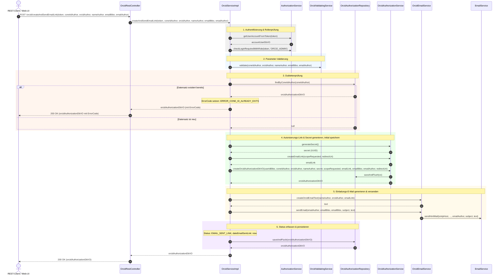
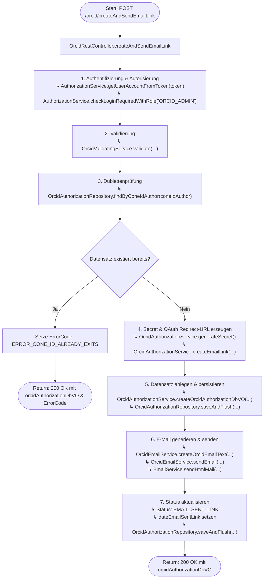

# Ablauf und Diagramme für `createAndSendEmailLink`

Dieses Dokument visualisiert den Ablauf, die Schnittstellen und die Methodenaufrufe der REST-Methode `createAndSendEmailLink` (`POST /orcid/createAndSendEmailLink`) in `OrcidRestController` bzw. `OrcidServiceImpl.createAndSendEmailLink`.

---

## 1. REST-Schnittstellen-Spezifikation

- **Endpunkt**: `POST /orcid/createAndSendEmailLink`
- **Controller**: `de.mpg.mpdl.inge.rest.web.controller.OrcidRestController`
- **HTTP-Header**:
  - `Authorization` (`token`): Token zur Authentifizierung und Autorisierung des Aufrufers.
- **Request-Parameter**:
  - `coneIdAuthor` (`String`, required): CoNE-ID des Autors.
  - `orcidAuthor` (`String`, required): ORCID-iD des Autors.
  - `nameAuthor` (`String`, required): Name des Autors.
  - `emailBibo` (`String`, required): E-Mail-Adresse der zuständigen Bibliothek / des Administrators.
  - `emailAuthor` (`String`, required): E-Mail-Adresse des Autors.
- **Response**: `ResponseEntity<OrcidAuthorizationDbVO>` (HTTP `200 OK`)

---

## 2. Verwendete Services und Komponenten

| Service / Komponente | Voll qualifizierter Klassenname / Interface | Beschreibung & Rolle im Ablauf | Aufgerufene Methoden |
| :--- | :--- | :--- | :--- |
| **`OrcidRestController`** | `de.mpg.mpdl.inge.rest.web.controller.OrcidRestController` | REST-Controller-Endpunkt für ORCID-Operationen; nimmt HTTP-POST-Requests entgegen und gibt die Response zurück. | `createAndSendEmailLink(...)` |
| **`OrcidService` / `OrcidServiceImpl`** | `de.mpg.mpdl.inge.service.pubman.OrcidService` `de.mpg.mpdl.inge.service.pubman.impl.OrcidServiceImpl` | Zentraler Orchestrierungsdienst; koordiniert Authentifizierung, Validierung, Dublettenprüfung, Erstellung der Autorisierungsdaten und E-Mail-Versand. | `createAndSendEmailLink(...)` |
| **`AuthorizationService`** | `de.mpg.mpdl.inge.service.aa.AuthorizationService` | Authentifizierung und Autorisierung des Aufrufers; prüft Token und Benutzerrolle (`ORCID_ADMIN`). | `getUserAccountFromToken(token)`, `checkLoginRequiredWithRole(token, role)` |
| **`OrcidValidatingService`** | `de.mpg.mpdl.inge.inge_validation.OrcidValidatingService` | Validiert Eingabeparameter (`coneIdAuthor`, `orcidAuthor`, `nameAuthor`, `emailBibo`, `emailAuthor`) über `FluentValidator` und spezifische Validatoren. | `validate(...)` |
| **`OrcidAuthorizationRepository`** | `de.mpg.mpdl.inge.db.repository.OrcidAuthorizationRepository` | Spring-Data-JPA-Repository für DB-Zugriffe auf `OrcidAuthorizationDbVO`; prüft vorhandene Datensätze und persistiert Änderungen. | `findByConeIdAuthor(coneIdAuthor)`, `saveAndFlush(vo)` |
| **`OrcidAuthorizationService` / `OrcidAuthorizationServiceImpl`** | `de.mpg.mpdl.inge.service.pubman.orcid.OrcidAuthorizationService` `de.mpg.mpdl.inge.service.pubman.impl.OrcidAuthorizationServiceImpl` | Domänenservice zur Generierung des OAuth-Secrets, Zusammenbau des ORCID-OAuth-Autorisierungslinks und Instanziierung des initialen DB-VOs. | `generateSecret()`, `createEmailLink(scope, redirectUri)`, `createOrcidAuthorizationDbVO(...)` |
| **`OrcidEmailService` / `OrcidEmailServiceImpl`** | `de.mpg.mpdl.inge.service.pubman.orcid.OrcidEmailService` `de.mpg.mpdl.inge.service.pubman.impl.OrcidEmailServiceImpl` | ORCID-spezifischer E-Mail-Dienst; lädt Template (`orcid_email.txt`), ersetzt Platzhalter und steuert den Mailversand. | `createOrcidEmailText(...)`, `sendEmail(...)` |
| **`EmailService`** | `de.mpg.mpdl.inge.service.pubman.EmailService` `de.mpg.mpdl.inge.service.pubman.impl.EmailServiceImpl` | Allgemeiner E-Mail-Versandservice der Anwendung; versendet die formatierte HTML-Mail über SMTP. | `sendHtmlMail(...)` |
| **`PropertyReader`** *(Hilfsklasse)* | `de.mpg.mpdl.inge.util.PropertyReader` | Liest Konfigurationsparameter (ORCID-URLs, Scopes, Betreffzeilen, SMTP-Host). | `getProperty(...)` |
| **`ResourceUtil`** *(Hilfsklasse)* | `de.mpg.mpdl.inge.util.ResourceUtil` | Liest Template-Dateien aus dem Classpath. | `getResourceAsString(...)` |

---

## 3. Sequenzdiagramm (Methoden-Aufrufreihenfolge)

---

## 4. Flussdiagramm (Entscheidungs- und Kontrollfluss)

---

## 5. Schritt-für-Schritt-Übersicht

1. **Controller-Einstieg & Authentifizierung**:
   - `OrcidRestController.createAndSendEmailLink(...)` nimmt den HTTP-POST-Request (`/orcid/createAndSendEmailLink`) entgegen.
   - `AuthorizationService.getUserAccountFromToken(token)` ermittelt das Benutzerkonto des Aufrufers (`AccountUserDbVO` / `userIdBibo`).
   - `AuthorizationService.checkLoginRequiredWithRole(...)` stellt sicher, dass der Aufrufer über die administrative Rolle `ORCID_ADMIN` verfügt.

2. **Validierung der Eingabeparameter**:
   - `OrcidValidatingService.validate(coneIdAuthor, orcidAuthor, nameAuthor, emailBibo, emailAuthor)` prüft Format und Vollständigkeit der übergebenen Autoren- und E-Mail-Daten mittels FluentValidator und spezifischer Validatoren (`ConeIdAuthorValidator`, `OrcidValidator`, `NameAuthorValidator`, `EmailBiboValidator`, `EmailAuthorValidator`, `ConeCheckValidator`).

3. **Dublettenprüfung**:
   - `OrcidAuthorizationRepository.findByConeIdAuthor(coneIdAuthor)` prüft, ob für den angegebenen CoNE-Autor bereits ein Autorisierungsdatensatz vorliegt.
   - Falls ein Datensatz bereits existiert, wird der Fehlercode `ERROR_CONE_ID_ALREADY_EXITS` gesetzt und der Datensatz direkt mit HTTP `200 OK` zurückgegeben.

4. **Secret- und Link-Generierung sowie Persistierung**:
   - `OrcidAuthorizationService.generateSecret()` erzeugt ein kryptografisches Einmal-Token (`secret`, UUID).
   - Die Redirect-URI mit dem Geheimschlüssel wird aufgebaut und via `OrcidAuthorizationService.createEmailLink(...)` in die OAuth-Autorisierungs-URL von ORCID eingebettet.
   - `OrcidAuthorizationService.createOrcidAuthorizationDbVO(...)` instanziiert das `OrcidAuthorizationDbVO` und persistiert es via `OrcidAuthorizationRepository.saveAndFlush(...)`.

5. **Versand der Einladungs-E-Mail**:
   - Betreff (`ORCID_EMAIL_SUBJECT_FOR_LINK`) und E-Mail-Vorlage (`orcid_email.txt`) werden geladen.
   - `OrcidEmailService.createOrcidEmailText(...)` ersetzt die Platzhalter (`$NAME_AUTHOR`, `$ORCID_AUTHOR`, `$EMAIL_LINK`).
   - `OrcidEmailService.sendEmail(emailAuthor, emailBibo, emailBibo, subject, text)` stößt den E-Mail-Versand an (Empfänger: `emailAuthor`, Absender/Reply-To: `emailBibo`) und delegiert an `EmailService.sendHtmlMail(...)`.

6. **Status-Aktualisierung & Rückgabe**:
   - Das Datum `dateEmailSentLink` und der Status `EMAIL_SENT_LINK` werden gesetzt.
   - Der Datensatz wird via `OrcidAuthorizationRepository.saveAndFlush(...)` aktualisiert und mit HTTP `200 OK` zurückgegeben.
