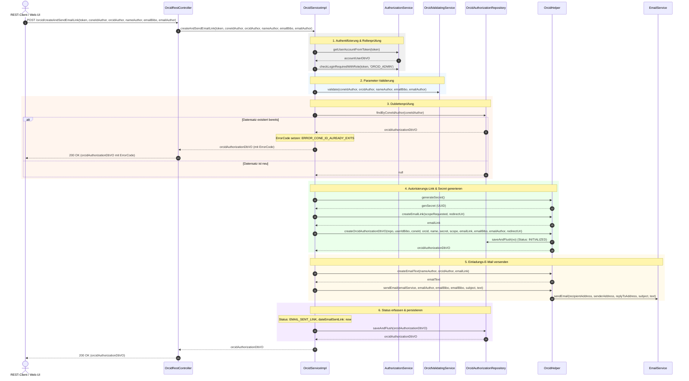
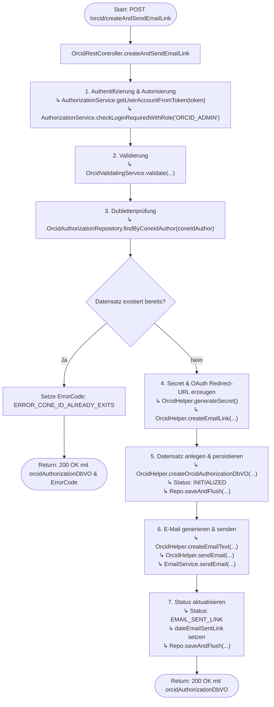

# Ablauf und Diagramme für `createAndSendEmailLink`

Dieses Dokument visualisiert den Ablauf, die Schnittstellen und die Methodenaufrufe der REST-Methode `createAndSendEmailLink` (`POST /orcid/createAndSendEmailLink`) in `OrcidRestController` bzw. `OrcidServiceImpl.createAndSendEmailLink`.

---

## 1. REST-Schnittstellen-Spezifikation

- **Endpunkt**: `POST /orcid/createAndSendEmailLink`
- **Controller**: `de.mpg.mpdl.inge.rest.web.controller.OrcidRestController`
- **HTTP-Header**:
  - `Authorization` (`token`): Token zur Authentifizierung des Aufrufers.
- **Request-Parameter**:
  - `coneIdAuthor` (`String`, required): CoNE-ID des Autors.
  - `orcidAuthor` (`String`, required): ORCID-iD des Autors.
  - `nameAuthor` (`String`, required): Name des Autors.
  - `emailBibo` (`String`, required): E-Mail-Adresse der zuständigen Bibliothek / des Administrators.
  - `emailAuthor` (`String`, required): E-Mail-Adresse des Autors.
- **Response**: `ResponseEntity<OrcidAuthorizationDbVO>` (HTTP `200 OK`)

---

## 2. Sequenzdiagramm (Methoden-Aufrufreihenfolge)

---

## 3. Flussdiagramm (Entscheidungs- und Kontrollfluss)

---

## 4. Schritt-für-Schritt-Übersicht

1. **Controller-Einstieg & Authentifizierung**:
   - `OrcidRestController.createAndSendEmailLink(...)` nimmt den HTTP-POST-Request (`/orcid/createAndSendEmailLink`) entgegen.
   - `AuthorizationService.getUserAccountFromToken(token)` ermittelt das Benutzerkonto des Aufrufers (`AccountUserDbVO` / `userIdBibo`).
   - `AuthorizationService.checkLoginRequiredWithRole(...)` stellt sicher, dass der Aufrufer über die administrative Rolle `ORCID_ADMIN` verfügt.

2. **Validierung der Eingabeparameter**:
   - `OrcidValidatingService.validate(coneIdAuthor, orcidAuthor, nameAuthor, emailBibo, emailAuthor)` prüft Format und Vollständigkeit der übergebenen Autoren- und E-Mail-Daten.

3. **Dublettenprüfung**:
   - `OrcidAuthorizationRepository.findByConeIdAuthor(coneIdAuthor)` prüft, ob für den angegebenen CoNE-Autor bereits ein Autorisierungsdatensatz vorliegt.
   - Falls ein Datensatz bereits existiert, wird der Fehlercode `ERROR_CONE_ID_ALREADY_EXITS` gesetzt und der Datensatz direkt mit HTTP `200 OK` zurückgegeben.

4. **Secret- und Link-Generierung**:
   - `OrcidHelper.generateSecret()` erzeugt ein kryptografisches Einmal-Token (`secret`, UUID).
   - Die Redirect-URI mit dem Geheimschlüssel wird aufgebaut und via `OrcidHelper.createEmailLink(...)` in die OAuth-Autorisierungs-URL von ORCID eingebettet.
   - `OrcidHelper.createOrcidAuthorizationDbVO(...)` instanziiert das `OrcidAuthorizationDbVO` mit dem Initialstatus `INITIALIZED` und persistiert es via `OrcidAuthorizationRepository.saveAndFlush(...)`.

5. **Versand der Einladungs-E-Mail**:
   - Betreff (`ORCID_EMAIL_SUBJECT_FOR_LINK`) und E-Mail-Vorlage (`orcid_email.txt`) werden geladen.
   - `OrcidHelper.createEmailText(...)` ersetzt die Platzhalter (`$NAME_AUTHOR`, `$ORCID_AUTHOR`, `$EMAIL_LINK`).
   - `OrcidHelper.sendEmail(emailService, emailAuthor, emailBibo, emailBibo, subject, text)` stößt den E-Mail-Versand via `EmailService` an (Absender: `emailAuthor`, Empfänger/Reply-To: `emailBibo`).

6. **Status-Aktualisierung & Rückgabe**:
   - Das Datum `dateEmailSentLink` und der Status `EMAIL_SENT_LINK` werden gesetzt.
   - Der Datensatz wird via `OrcidAuthorizationRepository.saveAndFlush(...)` aktualisiert und mit HTTP `200 OK` zurückgegeben.
