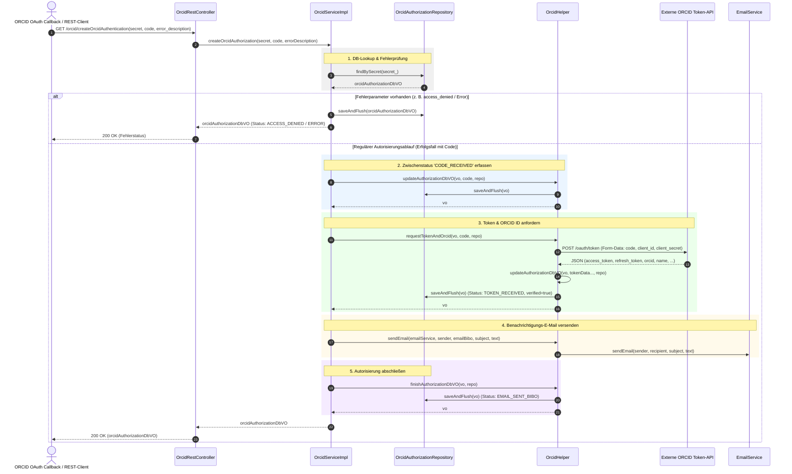
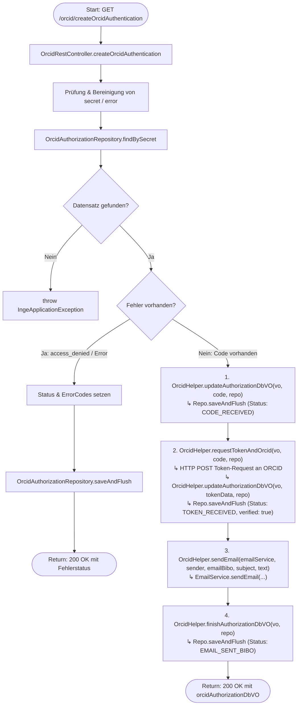

# Ablauf und Diagramme für `getOrcidAuthentication`

Dieses Dokument visualisiert den Ablauf, die Schnittstellen und die Methodenaufrufe der REST-Methode `getOrcidAuthentication` (`GET /orcid/createOrcidAuthentication`) in `OrcidRestController` bzw. `OrcidServiceImpl.createOrcidAuthorization`.

---

## 1. Sequenzdiagramm (Methoden-Aufrufreihenfolge)

---

## 2. Flussdiagramm (Entscheidungs- und Kontrollfluss)

---

## 3. Schritt-für-Schritt-Übersicht

1. **Controller-Einstieg & Lookup**:
   - `OrcidRestController.createOrcidAuthentication(...)` empfängt den Callback-Request von ORCID mit den Parametern `secret`, `code` und optional `error_description`.
   - `OrcidServiceImpl.createOrcidAuthorization(...)` bereinigt eventuelle Fehler-Query-Parameter im Secret und sucht den Autorisierungsdatensatz via `OrcidAuthorizationRepository.findBySecret(secret_)`.
   - Wenn kein Datensatz existiert, wird eine `IngeApplicationException` ausgelöst.

2. **Fehlerbehandlung (z. B. OAuth abgebrochen)**:
   - Falls ein Fehlerparameter übergeben wurde (z. B. `access_denied`), wird der Status entsprechend auf `ACCESS_DENIED` oder `ERROR` gesetzt, mit Zeitstempel (`dateError`) versehen und in der Datenbank persistiert.

3. **Empfang des Authorization Codes**:
   - `OrcidHelper.updateAuthorizationDbVO(vo, code, repo)` setzt `codeReceived`, das Datum `dateCodeReceived` und den Status `CODE_RECEIVED` und speichert diesen Zwischenstand.

4. **Token- und Profilabruf bei ORCID**:
   - `OrcidHelper.requestTokenAndOrcid(vo, code, repo)` sendet einen HTTP-POST-Request an den Token-Endpunkt von ORCID (`/oauth/token`).
   - Die JSON-Antwort mit `access_token`, `refresh_token`, `orcid` und Profilname wird geparst.
   - Der Datensatz wird auf `verified = true`, Status `TOKEN_RECEIVED` aktualisiert und persistiert.
   - Eventuelle Abweichungen zwischen dem registrierten Namen/ORCID und den Rückgabewerten werden als Warn-Codes erfasst.

5. **Benachrichtigung der Bibliothek**:
   - E-Mail-Absender, Betreff und Bestätigungstext werden aus den Properties geladen.
   - `OrcidHelper.sendEmail(...)` versendet die Erfolgsbenachrichtigung an die hinterlegte Bibliotheksadresse (`emailBibo`).

6. **Abschluss & Rückgabe**:
   - `OrcidHelper.finishAuthorizationDbVO(vo, repo)` setzt den Status auf `EMAIL_SENT_BIBO` sowie den Zeitstempel `dateEmailSentBibo`.
   - Der finale Datensatz wird persistiert und über den Controller als HTTP 200 OK zurückgegeben.
