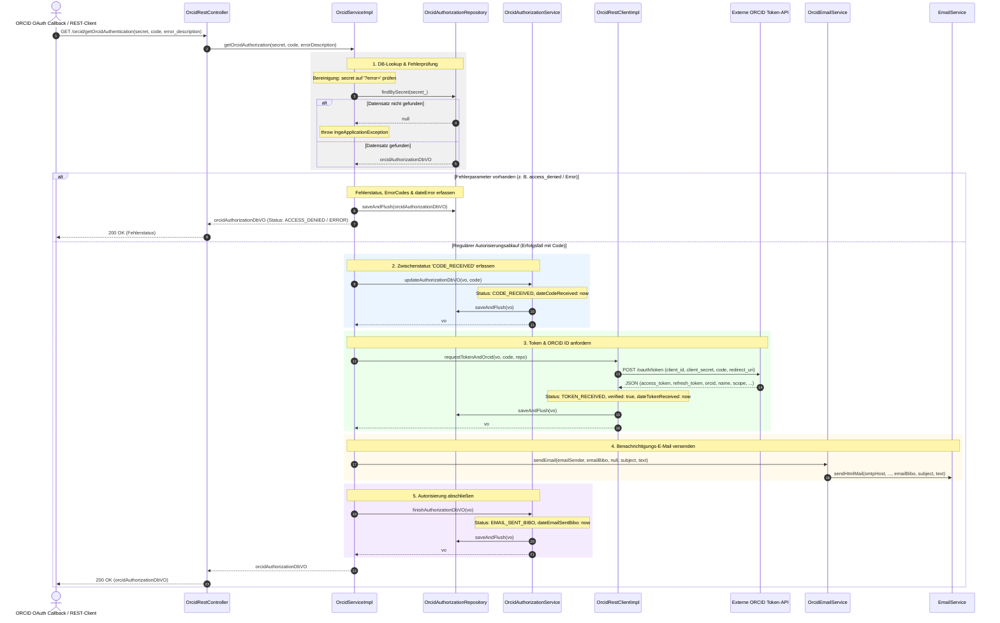
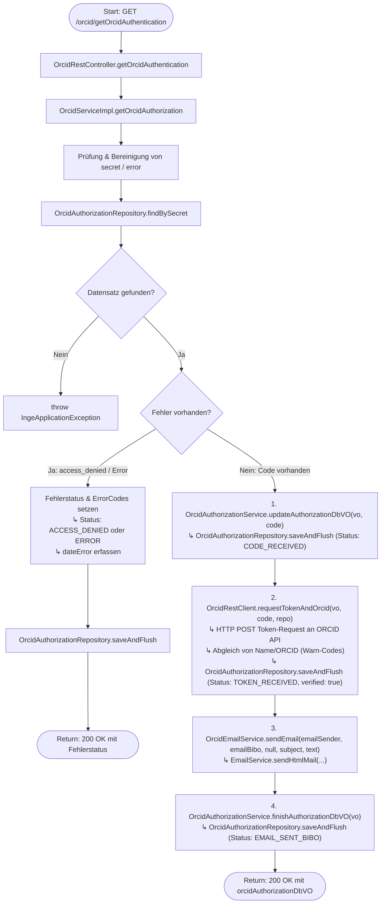

# Ablauf und Diagramme für `getOrcidAuthentication`

Dieses Dokument visualisiert den Ablauf, die Schnittstellen und die Methodenaufrufe der REST-Methode `getOrcidAuthentication` (`GET /orcid/getOrcidAuthentication`) in `OrcidRestController` bzw. `OrcidServiceImpl.getOrcidAuthorization`.

---

## 1. REST-Schnittstellen-Spezifikation

- **Endpunkt**: `GET /orcid/getOrcidAuthentication`
- **Controller**: `de.mpg.mpdl.inge.rest.web.controller.OrcidRestController`
- **Request-Parameter**:
  - `secret` (`String`, required): Einmal-Geheimschlüssel aus dem OAuth-Callback.
  - `code` (`String`, optional): Von ORCID übermittelter Authorization Code (im Erfolgsfall).
  - `error_description` (`String`, optional): Fehlerbeschreibung von ORCID (im Fehler-/Abbruchfall).
- **Response**: `ResponseEntity<OrcidAuthorizationDbVO>` (HTTP `200 OK`)

---

## 2. Verwendete Services und Komponenten

| Service / Komponente | Voll qualifizierter Klassenname / Interface | Beschreibung & Rolle im Ablauf | Aufgerufene Methoden |
| :--- | :--- | :--- | :--- |
| **`OrcidRestController`** | `de.mpg.mpdl.inge.rest.web.controller.OrcidRestController` | REST-Controller-Endpunkt für den OAuth-Callback von ORCID; nimmt HTTP-GET-Requests entgegen und gibt die Response zurück. | `getOrcidAuthentication(...)` |
| **`OrcidService` / `OrcidServiceImpl`** | `de.mpg.mpdl.inge.service.pubman.OrcidService` `de.mpg.mpdl.inge.service.pubman.impl.OrcidServiceImpl` | Zentraler Orchestrierungsdienst; koordiniert Fehlerbehandlung, Statusübergänge, Token-Abruf über REST-Client, Bibo-Benachrichtigung und Abschluss des Vorgangs. | `getOrcidAuthorization(...)` |
| **`OrcidAuthorizationRepository`** | `de.mpg.mpdl.inge.db.repository.OrcidAuthorizationRepository` | Spring-Data-JPA-Repository für DB-Zugriffe auf `OrcidAuthorizationDbVO`; sucht Autorisierungen anhand des Secrets und persistiert Statusänderungen. | `findBySecret(secret_)`, `saveAndFlush(vo)` |
| **`OrcidAuthorizationService` / `OrcidAuthorizationServiceImpl`** | `de.mpg.mpdl.inge.service.pubman.orcid.OrcidAuthorizationService` `de.mpg.mpdl.inge.service.pubman.impl.OrcidAuthorizationServiceImpl` | Domänenservice für Statusfortschritte; dokumentiert den Empfang des Codes (`CODE_RECEIVED`) und den Abschluss des Ablaufs (`EMAIL_SENT_BIBO`). | `updateAuthorizationDbVO(vo, code)`, `finishAuthorizationDbVO(vo)` |
| **`OrcidRestClient` / `OrcidRestClientImpl`** | `de.mpg.mpdl.inge.service.pubman.orcid.OrcidRestClient` `de.mpg.mpdl.inge.service.pubman.impl.OrcidRestClientImpl` | REST-Client für die externe ORCID-API; tauscht den Authorization Code via HTTP-POST (`/oauth/token`) gegen Access- und Refresh-Tokens ein und aktualisiert das VO (`TOKEN_RECEIVED`, `verified = true`). | `requestTokenAndOrcid(vo, code, repo)` |
| **`OrcidEmailService` / `OrcidEmailServiceImpl`** | `de.mpg.mpdl.inge.service.pubman.orcid.OrcidEmailService` `de.mpg.mpdl.inge.service.pubman.impl.OrcidEmailServiceImpl` | ORCID-spezifischer E-Mail-Dienst; steuert den Versand der Bestätigungs-E-Mail an die Bibliothek (`emailBibo`). | `sendEmail(...)` |
| **`EmailService`** | `de.mpg.mpdl.inge.service.pubman.EmailService` `de.mpg.mpdl.inge.service.pubman.impl.EmailServiceImpl` | Allgemeiner E-Mail-Versandservice der Anwendung; versendet die formatierte HTML-Mail über SMTP. | `sendHtmlMail(...)` |
| **`PropertyReader`** *(Hilfsklasse)* | `de.mpg.mpdl.inge.util.PropertyReader` | Liest Konfigurationsparameter (ORCID-URLs, Client-Credentials, Mailserver-Host, Bibo-Mailtexte, -Absender und -Betreffs). | `getProperty(...)` |

---

## 3. Sequenzdiagramm (Methoden-Aufrufreihenfolge)

---

## 4. Flussdiagramm (Entscheidungs- und Kontrollfluss)

---

## 5. Schritt-für-Schritt-Übersicht

1. **Controller-Einstieg & Lookup**:
   - `OrcidRestController.getOrcidAuthentication(...)` empfängt den Callback-Request von ORCID mit den Parametern `secret`, optional `code` und optional `error_description`.
   - `OrcidServiceImpl.getOrcidAuthorization(...)` bereinigt eventuelle Fehler-Query-Parameter im Secret (`?error=...`) und sucht den Autorisierungsdatensatz via `OrcidAuthorizationRepository.findBySecret(secret_)`.
   - Wenn kein Datensatz existiert, wird eine `IngeApplicationException` ausgelöst.

2. **Fehlerbehandlung (z. B. OAuth abgebrochen)**:
   - Falls ein Fehlerparameter übergeben wurde (z. B. `access_denied`), wird das Datum `dateError` gesetzt.
   - Der Status wird entsprechend auf `ACCESS_DENIED` oder `ERROR` gesetzt, `errorCodes` werden hinterlegt und der Datensatz wird in der Datenbank via `saveAndFlush(...)` persistiert und als HTTP `200 OK` zurückgegeben.

3. **Empfang des Authorization Codes**:
   - `OrcidAuthorizationService.updateAuthorizationDbVO(vo, code)` setzt `codeReceived`, das Datum `dateCodeReceived` und den Status `CODE_RECEIVED` und speichert diesen Zwischenstand via `OrcidAuthorizationRepository.saveAndFlush(...)` in der Datenbank.

4. **Token- und Profilabruf bei ORCID via `OrcidRestClient`**:
   - `OrcidRestClientImpl.requestTokenAndOrcid(vo, code, repo)` sendet einen HTTP-POST-Request an den Token-Endpunkt von ORCID (`/oauth/token`) mit `client_id`, `client_secret`, `grant_type=authorization_code`, `code` und `redirect_uri`.
   - Die JSON-Antwort mit `access_token`, `refresh_token`, `orcid`, `name`, `scope`, `token_type` und `expires_in` wird geparst.
   - Der Datensatz wird auf `verified = true`, Status `TOKEN_RECEIVED` und `dateTokenReceived` aktualisiert und persistiert.
   - Eventuelle Abweichungen zwischen dem registrierten Namen bzw. ORCID und den Rückgabewerten werden als Warn-Codes (`WARN_DIFFERENT_NAME`, `WARN_DIFFERENT_ORCID`) erfasst.

5. **Benachrichtigung der Bibliothek**:
   - E-Mail-Absender (`ORCID_EMAIL_SENDER_FOR_BIBO`), Betreff (`ORCID_EMAIL_SUBJECT_FOR_BIBO`) und Bestätigungstext (`ORCID_EMAIL_TEXT_FOR_BIBO`) werden aus den Properties geladen.
   - `OrcidEmailService.sendEmail(...)` versendet die Erfolgsbenachrichtigung an die hinterlegte Bibliotheksadresse (`emailBibo`) und delegiert an `EmailService.sendHtmlMail(...)`.

6. **Abschluss & Rückgabe**:
   - `OrcidAuthorizationService.finishAuthorizationDbVO(vo)` setzt den Status auf `EMAIL_SENT_BIBO` sowie den Zeitstempel `dateEmailSentBibo` und persistiert den Datensatz via `OrcidAuthorizationRepository.saveAndFlush(...)`.
   - Der finale Datensatz wird über den Controller als HTTP `200 OK` zurückgegeben.
