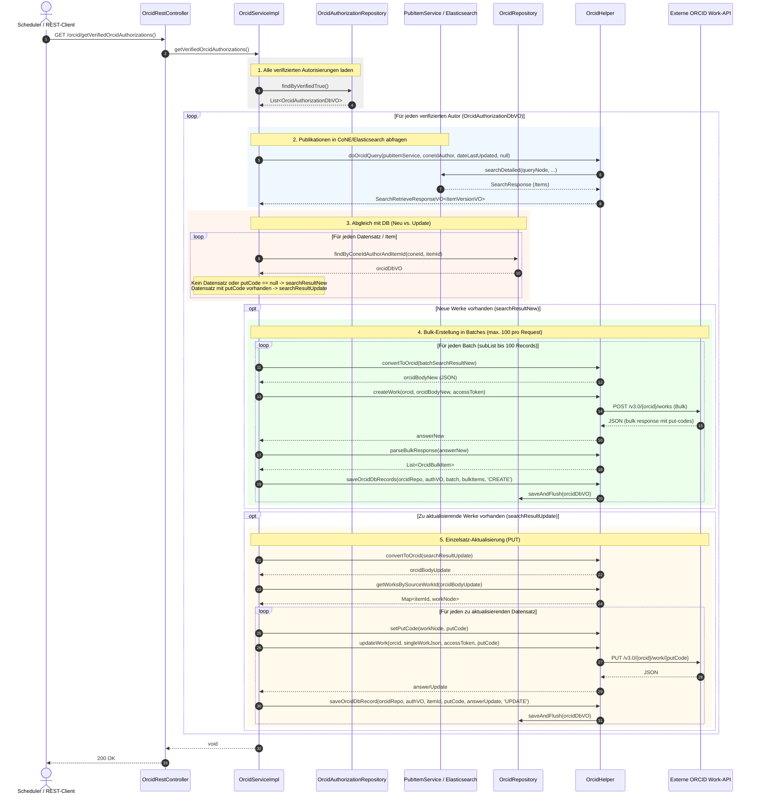
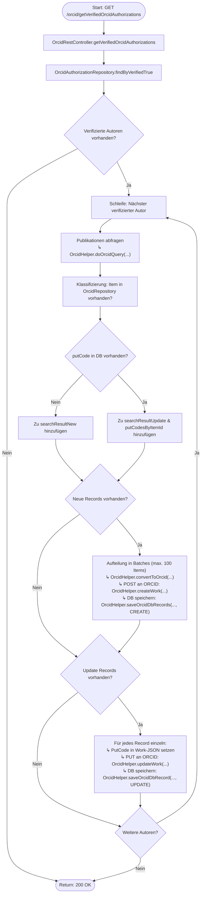

# Ablauf und Diagramme für `getVerifiedOrcidAuthorizations`

Dieses Dokument visualisiert den Ablauf, die Schnittstellen und die Methodenaufrufe der REST-Methode `getVerifiedOrcidAuthorizations` (`GET /orcid/getVerifiedOrcidAuthorizations`) in `OrcidRestController` bzw. `OrcidServiceImpl.getVerifiedOrcidAuthorizations`.

---

## 1. Sequenzdiagramm (Methoden-Aufrufreihenfolge)

---

## 2. Flussdiagramm (Entscheidungs- und Kontrollfluss)

---

## 3. Schritt-für-Schritt-Übersicht

1. **Controller-Einstieg & Ladevorgang**:
   - `OrcidRestController.getVerifiedOrcidAuthorizations()` stößt die Synchronisierung der Publikationen aller verifizierten Autoren an.
   - `OrcidAuthorizationRepository.findByVerifiedTrue()` lädt alle Benutzer mit aktiver, bestätigter ORCID-Verbindung (`verified = true`).

2. **Abfrage relevanter Publikationen**:
   - Für jeden Autor wird `OrcidHelper.doOrcidQuery(...)` ausgeführt.
   - `PubItemService.searchDetailed(...)` führt eine Elasticsearch-Suche nach allen Publikationen der zugehörigen CoNE-Autoren-ID (`coneIdAuthor`) durch.

3. **Klassifizierung in neue vs. geänderte Datensätze**:
   - Die Suchergebnisse werden iteriert und gegen `OrcidRepository.findByConeIdAuthorAndItemId(...)` geprüft:
     - **Neu (`searchResultNew`)**: Noch kein Eintrag in `OrcidRepository` vorhanden oder noch kein `putCode` vergeben.
     - **Update (`searchResultUpdate`)**: Eintrag mit existierendem `putCode` in der Datenbank vorhanden.

4. **Batch-Verarbeitung neuer Publikationen (`CREATE`)**:
   - `searchResultNew` wird in Blöcke von maximal 100 Datensätzen aufgeteilt (Vorgabe der ORCID-Bulk-API).
   - Jeder Block wird via `OrcidHelper.convertToOrcid(...)` in die ORCID-Bulk-Payload konvertiert.
   - `OrcidHelper.createWork(...)` sendet den Batch per HTTP-POST an `/v3.0/{orcid}/works`.
   - Die Antwort wird geparst (`OrcidHelper.parseBulkResponse`) und alle `putCode`s werden via `OrcidHelper.saveOrcidDbRecords(...)` im `OrcidRepository` mit Status `CREATE` persistiert.

5. **Einzelverarbeitung geänderter Publikationen (`UPDATE`)**:
   - `searchResultUpdate` wird konvertiert und in einzelne Werke aufgeteilt (`OrcidHelper.getWorksBySourceWorkId`).
   - Da die ORCID-API Updates nicht als Bulk-Payload erlaubt, wird jeder Datensatz einzeln abgearbeitet:
     - Der zugehörige `putCode` wird in den JSON-Knoten eingefügt (`OrcidHelper.setPutCode`).
     - `OrcidHelper.updateWork(...)` führt einen HTTP-PUT gegen `/v3.0/{orcid}/work/{putCode}` aus.
     - `OrcidHelper.saveOrcidDbRecord(...)` aktualisiert den Status und das Änderungsdatum im `OrcidRepository` mit Status `UPDATE`.

6. **Abschluss**:
   - Nach Abarbeitung aller Autoren liefert der Controller HTTP 200 OK zurück.
