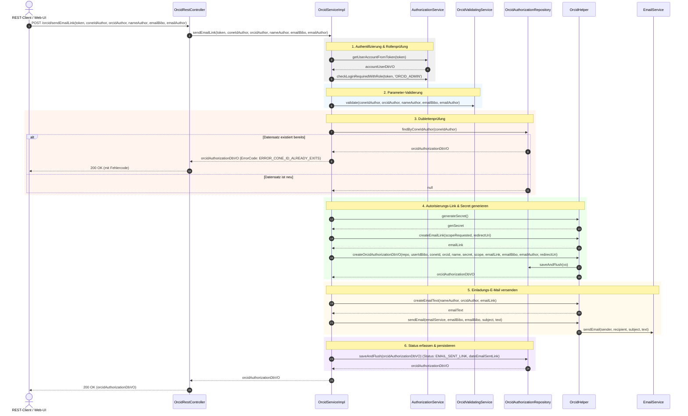
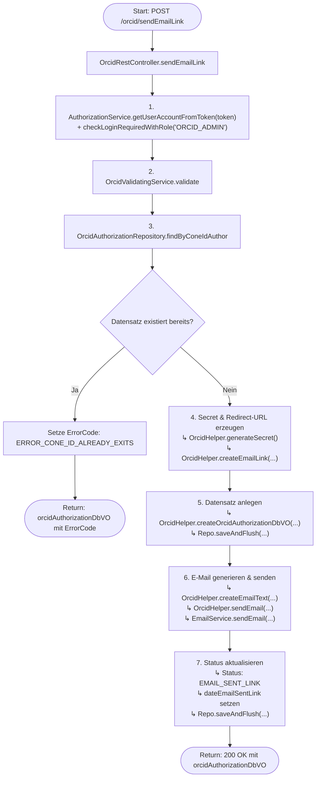

# Ablauf und Diagramme für `sendEmailLink`

Dieses Dokument visualisiert den Ablauf, die Schnittstellen und die Methodenaufrufe der REST-Methode `sendEmailLink` (`POST /orcid/sendEmailLink`) in `OrcidRestController` bzw. `OrcidServiceImpl`.

---

## 1. Sequenzdiagramm (Methoden-Aufrufreihenfolge)

---

## 2. Flussdiagramm (Entscheidungs- und Kontrollfluss)

---

## 3. Schritt-für-Schritt-Übersicht

1. **Controller-Einstieg & Authentifizierung**:
   - `OrcidRestController.sendEmailLink(...)` nimmt den HTTP-POST-Request entgegen.
   - `AuthorizationService.getUserAccountFromToken(token)` ermittelt den eingeloggten Bibo-Benutzer (`userIdBibo`).
   - `AuthorizationService.checkLoginRequiredWithRole(...)` verifiziert, dass der Aufrufer über die Rolle `ORCID_ADMIN` verfügt.

2. **Validierung der Eingabedaten**:
   - `OrcidValidatingService.validate(coneIdAuthor, orcidAuthor, nameAuthor, emailBibo, emailAuthor)` prüft Format und Konsistenz der übergebenen Autoren- und E-Mail-Daten.

3. **Dublettenprüfung**:
   - `OrcidAuthorizationRepository.findByConeIdAuthor(coneIdAuthor)` prüft, ob bereits eine Autorisierung für die CoNE-ID vorliegt.
   - Falls vorhanden, wird `ERROR_CONE_ID_ALREADY_EXITS` gesetzt und der Datensatz direkt zurückgegeben.

4. **Secret- und Link-Generierung**:
   - `OrcidHelper.generateSecret()` erzeugt einen kryptografischen Einmalschlüssel (`secret`).
   - Die Redirect-URI mit dem Geheimschlüssel wird aufgebaut und via `OrcidHelper.createEmailLink(...)` in die OAuth-Autorisierungs-URL von ORCID eingebettet.
   - `OrcidHelper.createOrcidAuthorizationDbVO(...)` instanziiert den Datensatz und speichert ihn in der Datenbank.

5. **Versand der Autorisierungs-E-Mail**:
   - Aus den Konfigurations-Properties werden Betreff und Vorlage geladen.
   - `OrcidHelper.createEmailText(...)` bereitet den E-Mail-Inhalt mit dem generierten OAuth-Link auf.
   - `OrcidHelper.sendEmail(emailService, ...)` stößt den Versand an die Bibliotheks-/Autoren-Adresse an.

6. **Status-Aktualisierung & Rückgabe**:
   - Das Datum `dateEmailSentLink` und der Status `EMAIL_SENT_LINK` werden gesetzt.
   - Der Datensatz wird via `OrcidAuthorizationRepository.saveAndFlush(...)` final persistiert und als HTTP 200 OK zurückgegeben.
