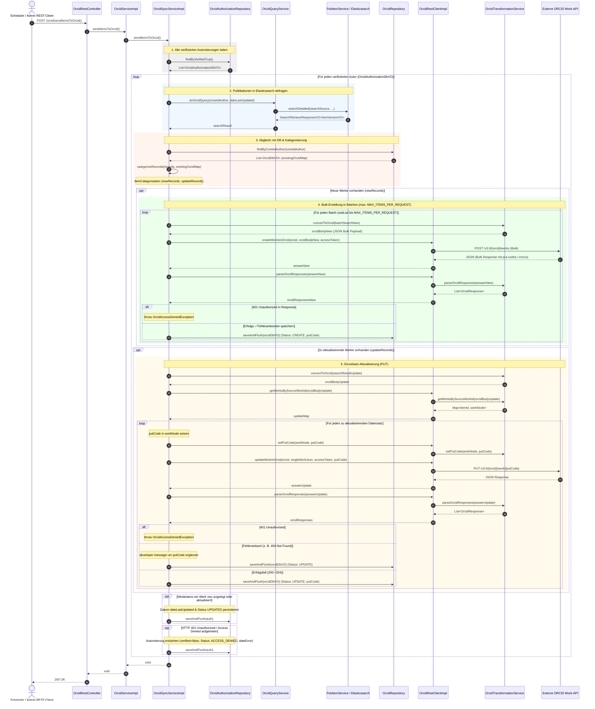

# Ablauf und Diagramme für `sendItemsToOrcid`

Dieses Dokument visualisiert den Ablauf, die Schnittstellen und die Methodenaufrufe der REST-Methode `sendItemsToOrcid` (`POST /orcid/sendItemsToOrcid`) in `OrcidRestController`, `OrcidServiceImpl.sendItemsToOrcid` bzw. `OrcidSyncServiceImpl.sendItemsToOrcid`.

---

## 1. REST-Schnittstellen-Spezifikation

- **Endpunkt**: `POST /orcid/sendItemsToOrcid`
- **Controller**: `de.mpg.mpdl.inge.rest.web.controller.OrcidRestController`
- **Request-Parameter**: Keine (wird typischerweise durch Scheduler oder administrativen Trigger aufgerufen).
- **Response**: `ResponseEntity<Void>` (HTTP `200 OK`)

---

## 2. Sequenzdiagramm (Methoden-Aufrufreihenfolge)

---

## 3. Flussdiagramm (Entscheidungs- und Kontrollfluss)

```mermaid
flowchart TD
    A([Start: POST /orcid/sendItemsToOrcid]) --> B[OrcidRestController.sendItemsToOrcid]
    B --> C[OrcidServiceImpl.sendItemsToOrcid]
    C --> D[OrcidSyncServiceImpl.sendItemsToOrcid]
    D --> E[OrcidAuthorizationRepository.findByVerifiedTrue]
    
    E --> F{Verifizierte Autoren vorhanden?}
    F -- Nein --> RetEnd([Return: 200 OK])
    F -- Ja --> G[Schleife: Nächster verifizierter Autor]
    
    G --> H["Publikationen in Elasticsearch suchen<br/>↳ OrcidQueryService.doOrcidQuery(...)"]
    H --> I{Publikationen gefunden?}
    I -- Nein --> NextAuthor{Weitere Autoren?}
    
    I -- Ja --> J["Bestehende DB-Einträge laden & kategorisieren<br/>↳ OrcidRepository.findByConeIdAuthor(...)<br/>↳ OrcidSyncServiceImpl.categorizeRecords(...)"]
    
    J --> K{Neue Records vorhanden?}
    K -- Ja --> L["Batches bilden (max. MAX_ITEMS_PER_REQUEST)<br/>↳ OrcidTransformationService.convertToOrcid(...)<br/>↳ POST an ORCID: OrcidRestClient.createWorksInOrcid(...)<br/>↳ OrcidTransformationService.parseOrcidResponses(...)<br/>↳ DB speichern: saveOrcidDbRecords(..., CREATE)"]
    K -- Nein --> M{Update Records vorhanden?}
    L --> M
    
    M -- Ja --> N["Für jedes Record einzeln:<br/>↳ PutCode im Work-JSON setzen<br/>↳ PUT an ORCID: OrcidRestClient.updateWorkInOrcid(...)<br/>↳ OrcidTransformationService.parseOrcidResponses(...)<br/>↳ Bei Erfolg: DB speichern (Status UPDATE, putCode)<br/>↳ Bei 404/Fehler: Developer-Message + putCode erfassen"]
    M -- Nein --> P{Änderungen durchgeführt?}
    N --> P
    
    P -- Ja --> Q["dateLastUpdated & Status UPDATED setzen<br/>↳ AuthRepo.saveAndFlush(auth)"]
    P -- Nein --> R{HTTP 401 aufgetreten?}
    Q --> R
    
    R -- Ja --> S["Zugriffsberechtigung entziehen<br/>↳ Status: ACCESS_DENIED, verified=false<br/>↳ dateError erfassen<br/>↳ AuthRepo.saveAndFlush(auth)"]
    R -- Nein --> NextAuthor
    S --> NextAuthor
    
    NextAuthor -- Ja --> G
    NextAuthor -- Nein --> RetEnd
```

---

## 4. Schritt-für-Schritt-Übersicht

1. **Controller-Einstieg & Delegation**:
   - `OrcidRestController.sendItemsToOrcid()` nimmt den POST-Request (`POST /orcid/sendItemsToOrcid`) entgegen.
   - Der Request wird über `OrcidServiceImpl.sendItemsToOrcid()` an die dedizierte Synchronisierungskomponente `OrcidSyncServiceImpl.sendItemsToOrcid()` delegiert.

2. **Laden der verifizierten Autorisierungen**:
   - `OrcidAuthorizationRepository.findByVerifiedTrue()` lädt alle Autorenkonten mit bestätigter und aktiver ORCID-Verknüpfung (`verified = true`).

3. **Publikationssuche in Elasticsearch**:
   - Für jeden Autor wird `OrcidQueryService.doOrcidQuery(coneIdAuthor, dateLastUpdated)` ausgeführt.
   - `PubItemService.searchDetailed(...)` führt eine Elasticsearch-Abfrage nach allen Publikationen der CoNE-Autoren-ID (`coneIdAuthor`) durch, die seit `dateLastUpdated` geändert wurden (`versionState = RELEASED`, `publicState != WITHDRAWN`).

4. **Kategorisierung in Neuanlagen und Aktualisierungen**:
   - `OrcidRepository.findByConeIdAuthor(coneIdAuthor)` lädt bereits synchronisierte Einträge in eine Map (`existingOrcidMap`).
   - `OrcidSyncServiceImpl.categorizeRecords(records, existingOrcidMap)` unterteilt die Treffer:
     - **`newRecords`**: Noch kein Eintrag in `OrcidRepository` vorhanden oder `putCode == null`.
     - **`updateRecords`**: Eintrag mit gültigem `putCode` in der Datenbank vorhanden.

5. **Batch-Verarbeitung neuer Publikationen (`CREATE`)**:
   - `newRecords` wird in Teilmengen von maximal `MAX_ITEMS_PER_REQUEST` (Property `ORCID_MAX_ITEMS_PER_REQUEST`) aufgeteilt.
   - Jeder Batch wird via `OrcidTransformationService.convertToOrcid(...)` in die ORCID-Bulk-JSON-Payload transformiert.
   - `OrcidRestClientImpl.createWorksInOrcid(orcid, body, accessToken)` sendet den HTTP-POST-Request an `/v3.0/{orcid}/works`.
   - Die Antwort wird geparst (`OrcidTransformationService.parseOrcidResponses`) und die `putCode`s werden via `OrcidSyncServiceImpl.saveOrcidDbRecords(...)` im `OrcidRepository` mit Status `CREATE` persistiert.

6. **Einzelverarbeitung geänderter Publikationen (`UPDATE`)**:
   - `updateRecords` wird konvertiert und via `OrcidTransformationService.getWorksBySourceWorkId(...)` in einzelne Werke aufgeteilt.
   - Für jedes Werk:
     - Der zugehörige `putCode` wird via `OrcidTransformationService.setPutCode(...)` im Work-JSON hinterlegt.
     - `OrcidRestClientImpl.updateWorkInOrcid(orcid, singleWorkJson, accessToken, putCode)` sendet einen HTTP-PUT-Request an `/v3.0/{orcid}/work/{putCode}`.
     - Bei Erfolg (200/204) wird der Status `UPDATE` und der `putCode` in der Datenbank persistiert.
     - Bei Fehlern (z. B. 404 Not Found) wird die `developer-message` um den `putCode` erweitert und im `OrcidDbVO` erfasst.

7. **Aktualisierung und Fehlerbehandlung**:
   - Wenn Werke angelegt oder modifiziert wurden, wird `dateLastUpdated` und der Status `UPDATED` im `OrcidAuthorizationDbVO` aktualisiert und persistiert.
   - Bei einem HTTP 401 Unauthorized (z. B. Token abgelaufen oder Berechtigung entzogen) wird `auth.setVerified(false)`, `auth.setStatus("ACCESS_DENIED")` und `auth.setDateError(now)` gesetzt und persistiert.
   - Nach Abarbeitung aller Autoren gibt der Controller HTTP `200 OK` zurück.
